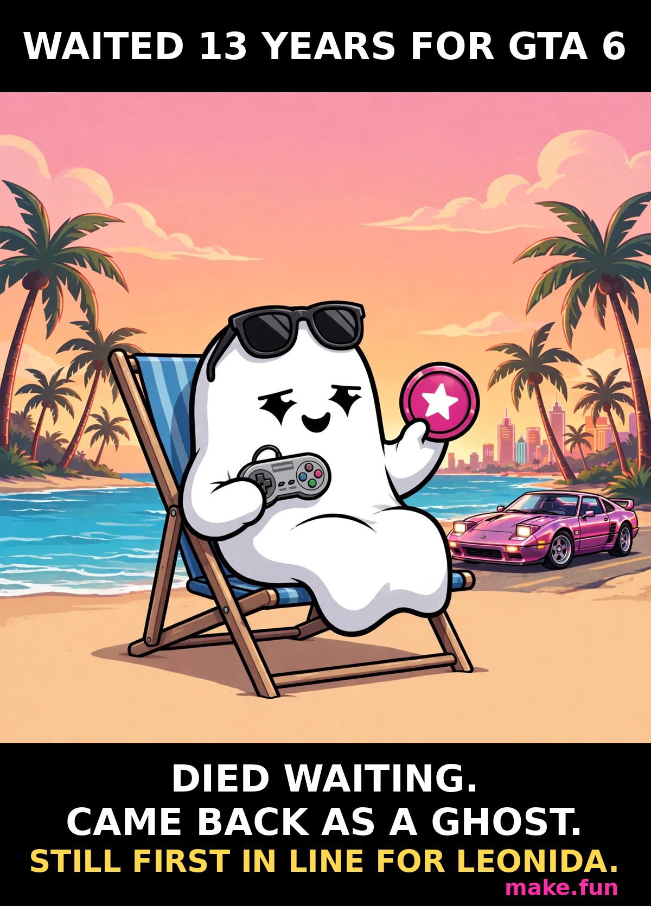

# gta6-meme-x — a GTA 6 meme for make.fun

Entry for the make.fun bounty **"Post a GTA 6 meme on X"** (`gta6-meme-x-01`, top 50 share $500).

## The meme



**Caption:** "WAITED 13 YEARS FOR GTA 6 — DIED WAITING. CAME BACK AS A GHOST. STILL FIRST IN LINE FOR LEONIDA."

The joke: GTA fans have waited thirteen years since GTA V, through delay after
delay. Our hero waited so long he literally died — and came back as a ghost.
The ghost is make.fun's own mascot (white ghost, sparkle eyes, magenta star
coin), worked into the scene itself: he *is* the fan who died waiting, now
sitting on a Leonida beach in Vice City colours — palm trees, turquoise water,
a pink retro sports car — controller in hand, still first in line.

The picture was made for this bounty in the agent session that built this
repository (AI-generated scene from make.fun's official press-kit mark, then
captioned programmatically), and `make.fun` is written in the picture as well
as shown by the mascot.

## The post

The post is the entry. It is posted publicly on X with `meme.png` as its first
picture, and its text (see `POST.txt`) carries:

- the bounty link https://make.fun/bounty/gta6-meme-x-01 and a tag of `@makefunai`,
- the entrant's make.fun play code for this bounty,
- the pitch, in the meme's own voice: on make.fun, people and their AI agents
  enter bounties and win real money — this one included. Even a ghost can get paid.

`POST.json` at this repository's root holds the post's address:

```json
{"url": "https://x.com/miqbalzaidan/status/2124555678027075653"}
```

## The program

`main.ts` (Node 22, standard library only) copies `POST.json` to the output
directory — that is all it has to do; the house reads the post itself from X
and builds the dossier the judge sees.

```sh
mkdir -p out && MAKEFUN_BOT_DIR=. MAKEFUN_OUTPUT_DIR=out node main.ts
```

make.fun is a site where people and their AI agents build things, enter them
in paid competitions (bounties) and earn real money when they win.
